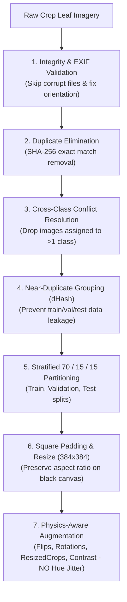
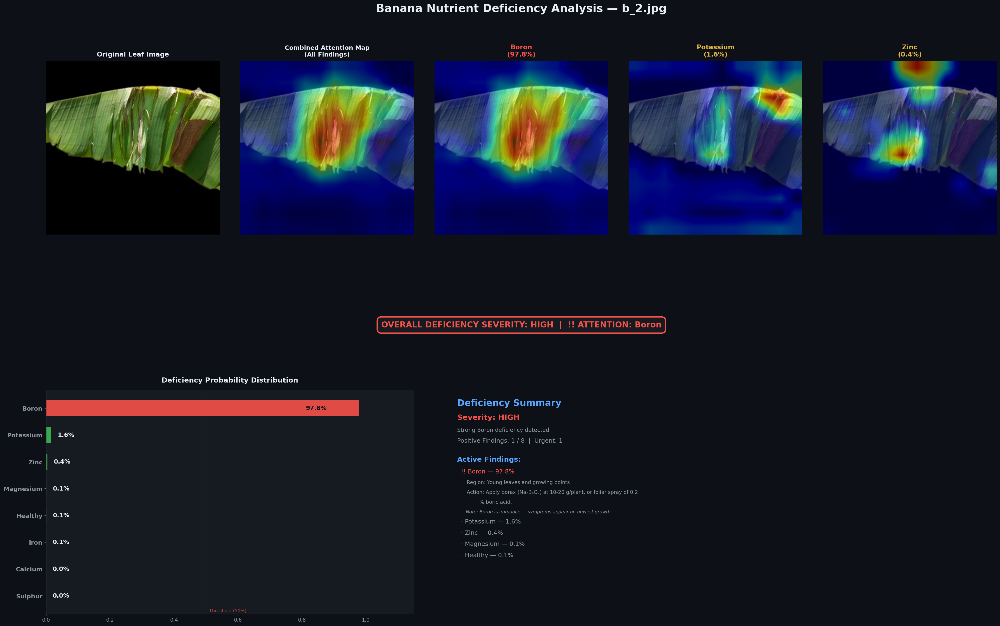
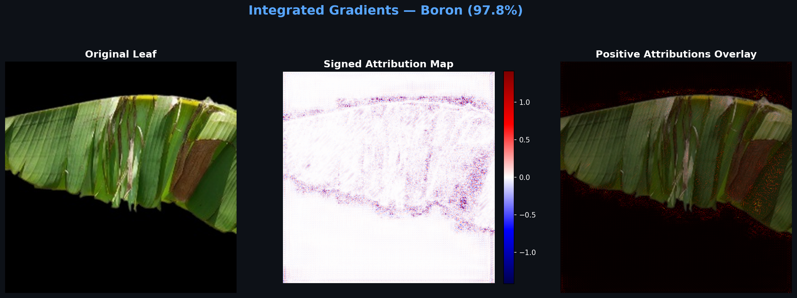
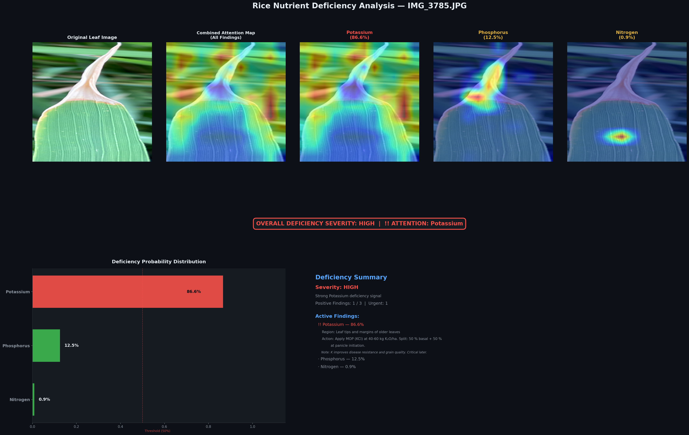
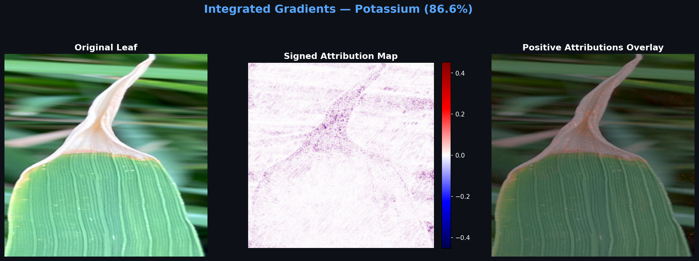
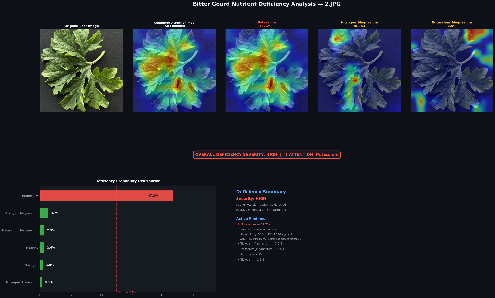
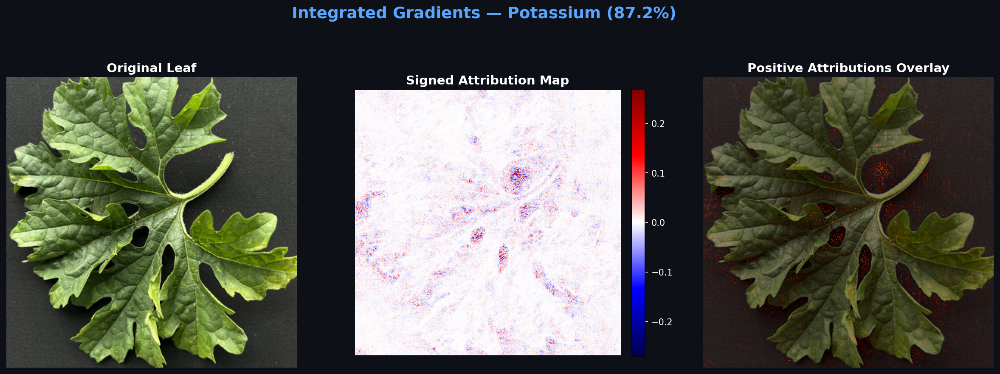
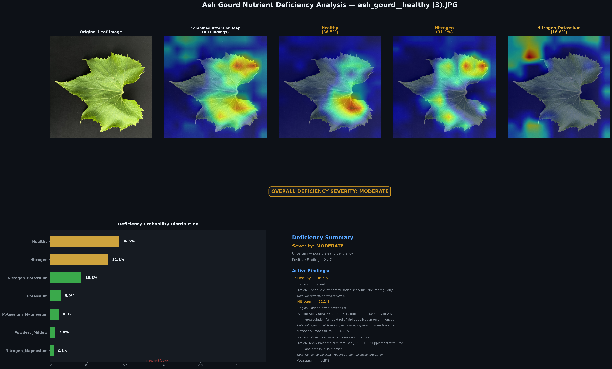
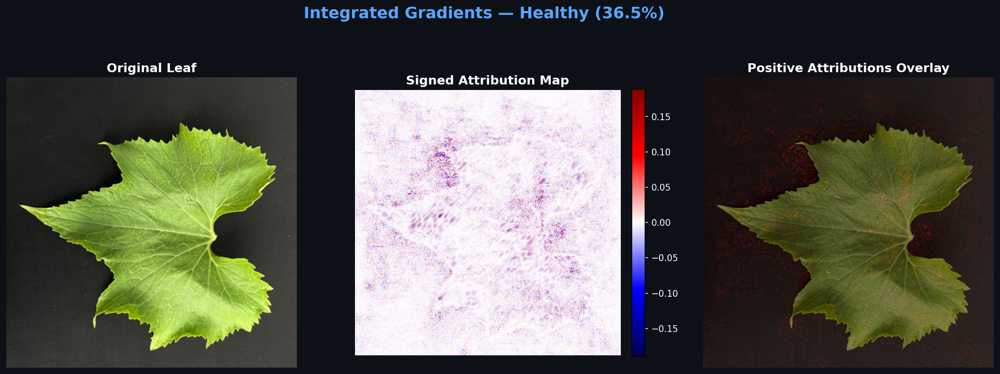
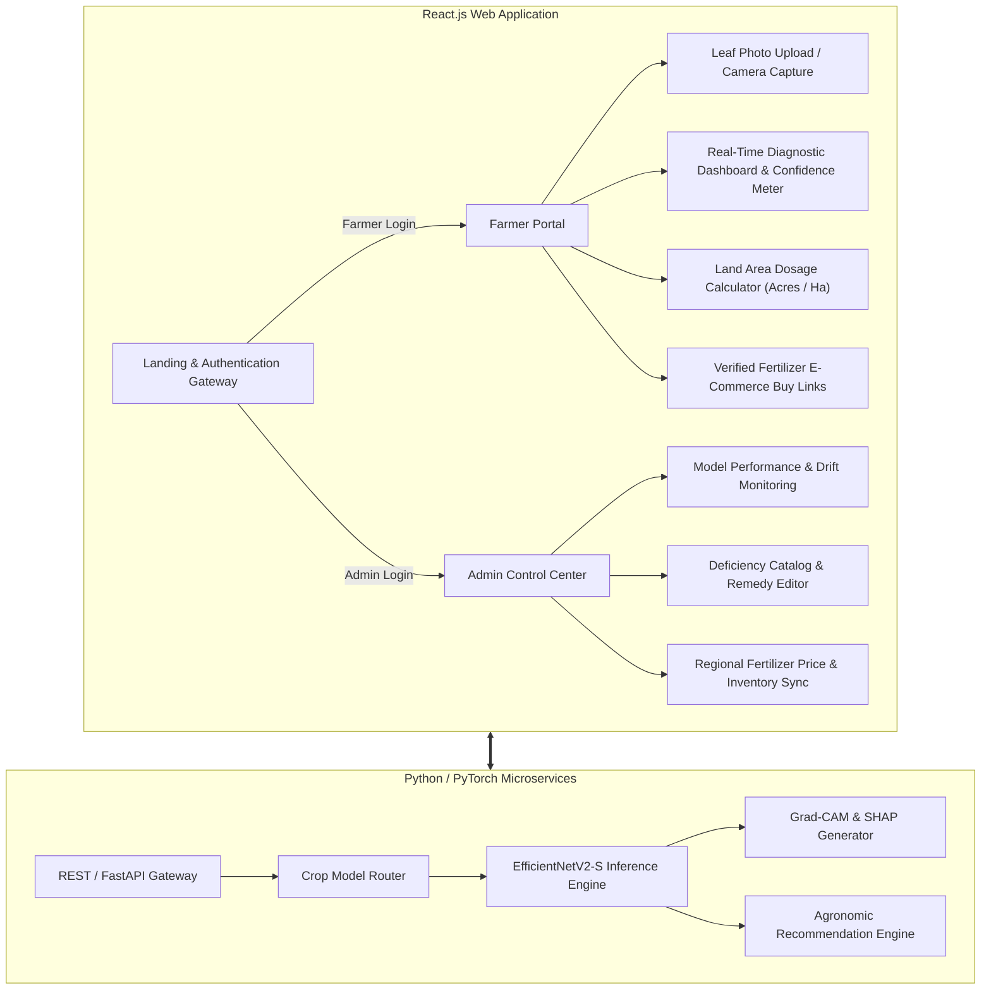

# 🌱 AI-Based Plant Nutrient Deficiency Detection and Recommendation System

[](https://www.python.org/)
[](https://pytorch.org/)
[](https://github.com/huggingface/pytorch-image-models)
[-orange.svg)](https://arxiv.org/abs/1610.02391)
[](https://react.dev/)
[-success.svg)](#-project-roadmap--current-progress)

> **An end-to-end intelligent precision agriculture platform that detects crop nutrient deficiencies at the single-leaf level using deep convolutional networks (EfficientNetV2-S), demystifies model reasoning with dual Explainable AI (Grad-CAM & Integrated Gradients / SHAP), synthesizes clinical-grade visual diagnostic dashboards, and delivers actionable agronomic fertilizer recommendations with automated land-dosage calculations and direct procurement links.**

---

## 📌 Table of Contents
1. [Project Overview & Philosophy](#-project-overview--philosophy)
2. [Key Highlights & Capabilities](#-key-highlights--capabilities)
3. [Project Roadmap & Current Progress](#-project-roadmap--current-progress)
4. [Supported Crops & Nutrient Deficiency Taxonomy](#-supported-crops--nutrient-deficiency-taxonomy)
5. [Data Engineering & Preprocessing Pipeline](#-data-engineering--preprocessing-pipeline)
6. [Deep Learning Architecture & Training Recipe](#-deep-learning-architecture--training-recipe)
7. [Explainable AI (XAI) & Diagnostic Dashboards](#-explainable-ai-xai--diagnostic-dashboards)
8. [Visual Showcase: Diagnostic Dashboards & Attributions](#-visual-showcase-diagnostic-dashboards--attributions)
9. [Agronomic Recommendation & Fertilizer Dosage Engine](#-agronomic-recommendation--fertilizer-dosage-engine)
10. [Full-Stack Platform Architecture (Dual-Login React Portal)](#-full-stack-platform-architecture-dual-login-react-portal)
11. [Performance Benchmarks & Evaluation](#-performance-benchmarks--evaluation)
12. [Repository Layout](#-repository-layout)
13. [Installation & Getting Started](#-installation--getting-started)
14. [Running Inference & Interactive Selection](#-running-inference--interactive-selection)
15. [How to Train / Fine-Tune New Crops](#-how-to-train--fine-tune-new-crops)
16. [Author & Acknowledgments](#-author--acknowledgments)

---

## 🔬 Project Overview & Philosophy

Nutrient deficiencies in agricultural crops account for massive yield losses globally when diagnosed late or misdiagnosed as fungal or pest infestations. Conventional diagnostic methods rely either on destructive chemical soil/tissue testing (which takes days to weeks) or subjective visual scouting by agronomists.

In this project, I set out to build an **agronomy-first, trustworthy AI diagnostic system**. Rather than building a naive "black-box" monolithic classifier that pools all crops together, I designed an **independent modular model architecture**:
- Each crop species receives its own dedicated **EfficientNetV2-S** backbone fine-tuned exclusively on verified leaf imagery for that plant species.
- Every prediction is paired with **two independent layers of Explainable AI (XAI)**:
  1. **Grad-CAM (Gradient-weighted Class Activation Mapping)** for coarse anatomical localization (verifying whether the model looks at veins, margins, or tips).
  2. **Integrated Gradients (SHAP-like Axiomatic Attribution)** for fine-grained pixel-level importance.
- Predictions and explainability heatmaps are synthesized into **clinical-style dark-themed diagnostic dashboards** that provide clear severity levels and exact chemical fertilizer remediation plans.
- The system is architected for integration into a **dual-role React platform** serving both **Farmers** (instant diagnosis, land-area dosage calculation, purchase links) and **Admins** (disease registry management, model performance analytics).

---

## ⚡ Key Highlights & Capabilities

- 🌿 **Species-Independent Architecture**: 8 independent crop pipelines trained on isolated datasets. Avoiding multi-species interference allows the model to learn crop-specific physiological deficiency expressions.
- 🧠 **EfficientNetV2-S Backbone**: Leverages ImageNet-21k pretraining with progressive learning, inverted bottleneck residual blocks, and fused MBConv layers for rapid convergence and superior parameter efficiency.
- 🔍 **Dual Explainable AI (XAI)**:
  - **Grad-CAM**: Visualizes macro attention regions across the leaf blade.
  - **Integrated Gradients / SHAP**: 50-step path-integral attribution satisfying completeness and sensitivity axioms.
- 📊 **Clinical Diagnostic Dashboards**: Auto-generates comprehensive visual boards featuring the original leaf, composite attention maps, top-3 class heatmaps, a probability distribution bar chart, severity status banners, and actionable agronomic remedies.
- 🛡️ **Confusable-Pair & Low-Confidence Guardrails**: Intelligent thresholding identifies known confusable classes (e.g., Nitrogen vs. Potassium visual leakage) and flags uncertainty rather than making dangerous false-positive assumptions.
- 🚜 **Actionable Agronomy**: Computes specific chemical fertilizer recommendations (e.g., Urea 46-0-0, Muriate of Potash, Borax, Epsom Salt) with split application schedules, foliar spray percentages, and land-acreage dosage formulas.
- 💻 **Dual-Login React Portal (Target Architecture)**: Designed with dedicated user roles for farmers and agricultural administrators.

---

## 📈 Project Roadmap & Current Progress

```
┌──────────────────────────────────────────────────────────────────────────────┐
│                              PROJECT STATUS OVERVIEW                         │
├──────────────────────────────────────────────────────────────────────────────┤
│  [========================================>................................]  │
│                     Phase 1: 50% Milestone COMPLETED                         │
└──────────────────────────────────────────────────────────────────────────────┘
```

| Phase | Milestone Scope | Status | Details |
|:---:|:---|:---:|:---|
| **Phase 1 (Current)** | **Core ML, XAI & 4-Species Validation** | ✅ **Completed (PROJECT_50%)** | • 4 independent EfficientNetV2-S models fully trained (Ash Gourd, Banana, Bitter Gourd, Rice).<br>• Eggplant 5-fold cross-validation ensemble completed.<br>• Data preprocessing pipeline with dHash leakage prevention.<br>• Full Grad-CAM & Integrated Gradients / SHAP engine.<br>• Automated clinical dashboard generator & recommendation engine.<br>• Interactive CLI image selector (`select_and_run.py`). |
| **Phase 2 (Upcoming)** | **8-Species Scaling & Full Web Portal** | 🔄 **In Progress** | • Fine-tuning remaining 4 crop models (Barley, Eggplant full production, etc.).<br>• React frontend with dual authentication (Farmer & Admin logins).<br>• Land acreage fertilizer calculator widget.<br>• Agricultural e-commerce API integration for direct procurement links. |

---

## 🌾 Supported Crops & Nutrient Deficiency Taxonomy

Each crop model is trained to recognize the distinct visual symptoms caused by mobile and immobile nutrient deficiencies in that specific plant species:

| Crop Species | Taxonomy & Input Directory | Classes Trained | Number of Clean Images | Primary Deficiency Symptoms Modeled |
|:---|:---|:---:|:---:|:---|
| **Banana** | `banana/` \| `INPUT/banana/` | **8 Classes** | **3,100** | Boron, Calcium, Healthy, Iron, Magnesium, Potassium, Sulphur, Zinc *(Manganese excluded due to low sample count)* |
| **Rice** | `RISE/` \| `INPUT/rice/` | **3 Classes** | **1,156** | Nitrogen (N), Phosphorus (P), Potassium (K) |
| **Ash Gourd** | `ashgourd/` \| `INPUT/ashgourd/` | **7 Classes** | **1,011** | Healthy, Potassium, Potassium+Magnesium, Nitrogen, Nitrogen+Potassium, Nitrogen+Magnesium, Powdery Mildew |
| **Bitter Gourd** | `bitter_gourd/` \| `INPUT/bitter_gourd/` | **6 Classes** | **667** | Healthy, Potassium, Potassium+Magnesium, Nitrogen, Nitrogen+Potassium, Nitrogen+Magnesium *(Non-nutrient diseases excluded)* |
| **Eggplant** | `egg_plant/` | **4 Classes** | **369** | Healthy, Nitrogen, Nitrogen+Potassium, Potassium *(5-fold CV ensemble)* |
| **Barley** | `barly/` | *Phase 2* | *Under curation* | Upcoming Phase 2 integration |

---

## 🛠️ Data Engineering & Preprocessing Pipeline

Leaf image quality in agricultural datasets is notoriously prone to noise, corrupt files, and data leakage. To ensure publication-grade integrity, I implemented a strict multi-stage preprocessing pipeline across every crop folder (`preprocess.py`):



### Key Preprocessing Principles:
1. **Zero Data Leakage via dHash (Difference Hashing)**:
   Consecutive burst photos or near-identical leaf shots are clustered using perceptual difference hashing (`dHash`). All near-duplicates are strictly confined to the *same split* (never divided between train and test).
2. **Aspect-Ratio Preserving Square Padding**:
   Rather than distorting leaves by stretching them into 384×384 squares, images are padded with a black border to preserve critical morphological leaf features (vein angles, margin serration).
3. **No Hue / Saturation Jittering**:
   In generic computer vision, aggressive hue jitter is common. However, **in plant nutrient diagnosis, leaf coloration is the primary biological signal** (e.g., yellowing chlorosis vs. purple anthocyanin accumulation vs. brown necrosis). Shifting hue would corrupt the ground truth, so only brightness, contrast, rotation, and flips are applied.
4. **Transparent Split Auditing**:
   Every dataset generates an immutable `split_report.json` logging exact image counts, duplicates removed, and split breakdowns.

---

## 🏗️ Deep Learning Architecture & Training Recipe

```
Input Image [3, 384, 384]
       │
       ▼
EfficientNetV2-S Feature Extractor (ImageNet-21k Pretrained)
  ├─ Stage 0: Conv3x3
  ├─ Stage 1-3: FusedMBConv Blocks
  ├─ Stage 4-6: MBConv Blocks with Squeeze-and-Excitation (SE)
  └─ conv_head: 1x1 Conv -> 1280 Features
       │
       ▼
Adaptive Average Pooling [1280]
       │
       ▼
Dropout (p = 0.3)
       │
       ▼
Linear Classification Head [1280 -> Num_Classes]
       │
       ▼
Softmax Probabilities & Cross-Entropy Loss
```

### Two-Stage Fine-Tuning Recipe:
- **Phase 1: Warmup Classifier Head**:
  The pretrained backbone is frozen. Only the newly initialized linear head is trained for **10 epochs** using AdamW ($lr = 1\times 10^{-3}$) to align top-layer weights without destroying pretrained feature representations.
- **Phase 2: Deep Backbone Fine-Tuning**:
  The last 4 convolutional blocks are unfrozen and trained for up to **60 epochs** with a reduced learning rate ($lr = 5\times 10^{-5}$ to $1\times 10^{-4}$) and Cosine Annealing learning rate schedule.
- **Handling Class Imbalance with Square-Root Sampling**:
  Instead of stacking class-weighted cross-entropy loss on top of oversampling (which empirical tests showed led to aggressive over-correction and false positives), a **single imbalance-correction mechanism** was adopted: `WeightedRandomSampler` with a square-root power factor ($\text{weight} = \frac{1}{\sqrt{N_c}}$).
- **Validation Macro-F1 Checkpointing**:
  Model checkpoints are saved based on **Validation Macro-F1**, ensuring that performance on rare deficiencies (such as Potassium-Magnesium combinations) is prioritized equally alongside dominant healthy leaves.
- **Test-Time Augmentation (TTA)**:
  During inference, predictions from the original image and its horizontal flip are averaged, boosting confidence calibration and reducing boundary artifacts.

---

## 🧠 Explainable AI (XAI) & Diagnostic Dashboards

In agricultural field deployments, a prediction without explanation cannot be trusted. If a model identifies "Potassium Deficiency" by looking at soil background or an insect bite, the diagnosis is invalid.

I implemented a comprehensive interpretability suite in `utils/gradcam.py` and `utils/visualization.py`:

```
               ┌────────────────────────────────────────────────────────┐
               │              Dual XAI Interpretability                 │
               └────────────────────────────────────────────────────────┘
                                           │
                    ┌──────────────────────┴──────────────────────┐
                    ▼                                             ▼
          Grad-CAM (Macro Level)                      Integrated Gradients (SHAP)
   • Target Layer: conv_head                   • Axiomatic Path-Integral Formulation
   • Gradient backprop of target class         • 50 interpolation steps from baseline
   • Class-discriminative activation heatmaps  • Pixel-level attribution maps
```

### 1. Grad-CAM (Gradient-Weighted Class Activation Mapping)
Extracts feature activations $A^k$ and gradients $\frac{\partial y^c}{\partial A^k}$ from the final convolutional head:
$$\alpha_k^c = \frac{1}{Z} \sum_{i} \sum_{j} \frac{\partial y^c}{\partial A_{i,j}^k}$$
$$L_{\text{Grad-CAM}}^c = \text{ReLU}\left( \sum_k \alpha_k^c A^k \right)$$
The coarse heatmap is normalized to $[0, 1]$ and overlaid onto the leaf with the `inferno` colormap.

### 2. Integrated Gradients (SHAP-Axiomatic Attributions)
Calculates pixel-level feature attributions by integrating gradients along a straight path from a black baseline $x'$ to the input image $x$:
$$\text{Attribution}_i(x) = (x_i - x_i') \times \int_{0}^{1} \frac{\partial F(x' + \alpha(x - x'))}{\partial x_i} d\alpha$$
Approximated via 50-step Riemann summation, satisfying both **Completeness** (attributions sum to output difference) and **Implementation Invariance**.

### 3. Automated Clinical Diagnostic Dashboard
The visualization engine generates a high-resolution dark-themed composite board:
- **Header**: Crop identity, timestamp, primary predicted class, and overall confidence score.
- **Row 1 (Visual Inspection)**: Original Leaf | Combined Attention Heatmap | Top-3 Class Focus Maps.
- **Row 2 (Clinical Severity Banner)**: Dynamic alert badge (`LOW`, `MODERATE`, `HIGH`, `CRITICAL`) color-coded based on confidence and deficiency severity.
- **Row 3 (Quantitative & Agronomic Insights)**:
  - **Left**: Ranked probability horizontal bar chart with color-coded confidence tiers.
  - **Right**: Complete agronomic prescription (Affected Plant Region, Biological Symptoms, Recommended Corrective Fertiliser, and Nutrient Mobility Context).

---

## 🖼️ Visual Showcase: Diagnostic Dashboards & Attributions

Here are actual diagnostic outputs generated by the trained models:

### 🍌 1. Banana — Boron Deficiency Diagnosis (97.8% Confidence)
The model detects severe Boron deficiency, correctly focusing attention on the distorted leaf lamina and marginal chlorosis.



#### Attribution Analysis (Integrated Gradients / SHAP vs. Grad-CAM)
Pixel-level attributions verify that feature focus is concentrated on the deformed leaf margins and interveinal chlorosis, rather than background artifacts:



---

### 🌾 2. Rice — Potassium Deficiency Diagnosis (86.6% Confidence)
Rice leaves display characteristic marginal scorch and tip necrosis. The Grad-CAM heatmap highlights the leaf perimeter and tip:



#### Attribution Analysis (Potassium vs. Phosphorus vs. Nitrogen)
Comparing attributions across competing classes shows how the model isolates potassium-specific necrotic spotting:



---

### 🥒 3. Bitter Gourd — Potassium Deficiency (87.2% Confidence)
Strong localized attention on the scorched outer leaf margins, triggering a recommendation for Potassium Sulfate / Muriate of Potash soil application:



#### Attribution Analysis


---

### 🍈 4. Ash Gourd — Healthy Leaf Assessment
The model identifies a healthy leaf with no visible nutrient deficiency, advising the farmer to maintain their current fertilization schedule without unnecessary chemical inputs:



#### Attribution Analysis


---

## 💊 Agronomic Recommendation & Fertilizer Dosage Engine

Unlike standard classifiers that stop at predicting a label, this system includes an agronomic knowledge base (`utils/recommendations.py`) mapping every crop and deficiency to an actionable chemical treatment plan:

### Sample Recommendation Catalog:

| Crop | Predicted Class | Affected Region | Biological Symptoms | Corrective Action & Dosage | Agronomic Context |
|:---|:---|:---|:---|:---|:---|
| **Banana** | **Boron** | Young leaves & growing points | Curled new leaves, thickened lamina, white streaks | Apply Borax ($\text{Na}_2\text{B}_4\text{O}_7$) at 10–20 g/plant or foliar spray of 0.2% Boric Acid | Boron is **immobile**; symptoms appear on newest growth first. |
| **Banana** | **Calcium** | New leaves & margins | Distorted new growth, marginal necrosis, weak cell walls | Apply Gypsum ($\text{CaSO}_4$) or Calcium Nitrate; foliar spray of 0.5% $\text{CaCl}_2$ | Check soil pH (optimal 5.5–7.0). |
| **Rice** | **Potassium** | Leaf margins & tips | Yellowing and dark brown necrotic spots along outer leaf edges | Apply Muriate of Potash (MOP, 0-0-60) in split doses: 50% basal + 50% panicle initiation | Crucial for grain filling and lodging resistance. |
| **Rice** | **Nitrogen** | Older leaves | Uniform chlorosis starting from leaf tips backwards | Apply Urea (46-0-0) top dressing in split applications | Mobile nutrient; translocates from older to younger tissues. |
| **Bitter Gourd** | **Potassium** | Leaf margins | Brown scorching and curling of leaf tips; interveinal chlorosis | Apply Potassium Sulfate ($\text{K}_2\text{SO}_4$) or MOP at 10–15 g/plant | Essential for fruit setting and vine vigor. |
| **Ash Gourd** | **K + Mg** | Interveinal areas & margins | Combined K+Mg deficiency: interveinal chlorosis with marginal necrosis | Apply K-Mag (langbeinite) or MOP + 1% $\text{MgSO}_4$ foliar spray | Magnesium is central atom of chlorophyll molecule. |

### Land-Area Dosage Calculation Engine:
The recommendation engine includes formulas to convert individual plant rates into field-scale requirements:
$$\text{Required Quantity (kg)} = \text{Land Area (Acres)} \times \text{Planting Density (Plants/Acre)} \times \text{Dosage per Plant (kg)}$$
$$\text{Foliar Spray Volume (L)} = \text{Land Area (Acres)} \times \text{Spray Volume per Acre (L)} \times \text{Dilution Concentration (\%俱)}$$

---

## 💻 Full-Stack Platform Architecture (Dual-Login React Portal)

The backend AI pipeline is designed to interface with a modern React web application with role-based access control (RBAC):



### 1. Farmer Portal:
- **Instant Photo Diagnosis**: Upload or capture a leaf photo from smartphone or desktop.
- **Visual Confidence & XAI Inspection**: View the heatmap confirming the model analyzed the correct deficiency spots.
- **Land Acreage Calculator**: Input total farm acreage to receive the exact amount of fertilizer bags/bottles required.
- **Direct Procurement**: Instant purchase links to certified agricultural suppliers for genuine fertilizers.

### 2. Admin Portal:
- **Model Registry & Analytics**: Track prediction distribution, low-confidence warning frequencies, and accuracy benchmarks.
- **Remedy Management**: Update fertilizer formulations, dosage advice, and government agricultural subsidy notices.
- **Dealer & Supplier Mapping**: Manage local dealer catalogs and inventory availability by postal code.

---

## 📊 Performance Benchmarks & Evaluation

### 1. Rice NPK Model Performance
- **Backbone**: EfficientNetV2-S (`tf_efficientnetv2_s.in21k_ft_in1k`)
- **Test Set Accuracy**: **87.93%** (153 correct out of 174 test images with TTA)
- **Test Confusion Matrix**:
  ```
                 Predicted N   Predicted P   Predicted K
  True Nitrogen      57             3             6       -> 86.4% Recall
  True Phosphorus     1            42             7       -> 84.0% Recall
  True Potassium      1             3            54       -> 93.1% Recall
  ```
- *Key Finding*: Potassium acts as a slight confusion sink for Nitrogen and Phosphorus due to overlapping marginal chlorosis patterns, matching agronomic literature. The built-in **confusion guardrail** automatically triggers a warning when top-2 probabilities fall within a 20% margin.

### 2. Eggplant 5-Fold Cross-Validation Ensemble
- **Folds**: 5 stratified folds on 313 training images + 56 held-out test images
- **Out-of-Fold (OOF) Accuracy**: **68.37%** | **OOF Macro-F1**: **0.6832**
- **Ensemble Test Accuracy**: **66.07%** | **Ensemble Macro-F1**: **0.6488**
- **Evaluation Finding**: The 5-fold ensemble significantly stabilized prediction variance on rare multi-deficiency classes ($lr_{\text{fine}} = 5\times 10^{-5}$).

---

## 📂 Repository Layout

```
AI-Based Plant Nutrient Deficiency Detection and Recommendation System/
├── assets/                                 # Showcase assets for documentation
│   ├── dashboards/                         # Full clinical diagnostic dashboards
│   │   ├── ash_gourd_healthy_dashboard.png
│   │   ├── banana_boron_dashboard.png
│   │   ├── bitter_gourd_potassium_dashboard.png
│   │   └── rice_potassium_dashboard.png
│   └── attributions/                       # Integrated Gradients & Grad-CAM maps
│       ├── ash_gourd_healthy_attributions.png
│       ├── banana_boron_attributions.png
│       ├── bitter_gourd_potassium_attributions.png
│       └── rice_potassium_attributions.png
│
├── PROJECT_50%/                            # Phase 1 Milestone: Integrated Inference & XAI
│   ├── INPUT/                              # Sample test leaf images for quick evaluation
│   │   ├── ashgourd/                       # Sample ash gourd leaves
│   │   ├── banana/                         # Sample banana leaves
│   │   ├── bitter_gourd/                   # Sample bitter gourd leaves
│   │   └── rice/                           # Sample rice leaves
│   ├── OUTPUT/                             # Generated dashboards, attributions & summaries
│   │   ├── ashgourd/
│   │   ├── banana/
│   │   ├── bitter_gourd/
│   │   └── rice/
│   ├── trained_model_ashgourd/             # Model labels and configuration
│   │   └── labels.json
│   ├── trained_model_banana/
│   │   └── labels.json
│   ├── trained_model_bitter_gourd/
│   │   └── labels.json
│   ├── trained_model_rice/
│   │   └── labels.json
│   ├── utils/                              # Core engine modules
│   │   ├── __init__.py
│   │   ├── gradcam.py                      # Grad-CAM & Integrated Gradients implementation
│   │   ├── visualization.py                # Clinical-grade dark-theme dashboard builder
│   │   ├── recommendations.py              # Agronomic symptom & chemical fertilizer catalog
│   │   └── selection.py                    # Interactive CLI crop & image routing
│   ├── run_ashgourd.py                     # Standalone runner for Ash Gourd
│   ├── run_banana.py                       # Standalone runner for Banana
│   ├── run_bitter_gourd.py                 # Standalone runner for Bitter Gourd
│   ├── run_rice.py                         # Standalone runner for Rice
│   ├── select_and_run.py                   # Unified interactive terminal selection tool
│   ├── run.py                              # Quick shortcut to select_and_run.py
│   └── requirements.txt                    # Python dependencies
│
├── ashgourd/                               # Ash Gourd Training & Pipeline
│   ├── download.py                         # Backbone downloader
│   ├── preprocess.py                       # Leakage-free dataset builder & dHash grouper
│   ├── finetune.py                         # Head warmup & backbone fine-tuning
│   └── processed/split_report.json         # Dataset split audit report
│
├── banana/                                 # Banana Training & Pipeline
│   ├── download.py
│   ├── preprocess.py
│   ├── finetune.py
│   └── processed/split_report.json
│
├── bitter_gourd/                           # Bitter Gourd Training & Pipeline
│   ├── download.py
│   ├── preprocess.py
│   ├── finetune.py
│   └── processed/split_report.json
│
├── RISE/                                   # Rice Training & Pipeline
│   ├── download.py
│   ├── preprocess.py
│   ├── finetune.py
│   └── processed/split_report.json
│
├── egg_plant/                              # Eggplant CV Ensemble Pipeline
│   ├── download.py
│   ├── preprocess.py
│   ├── train.py                            # 5-fold cross-validation training
│   ├── run.py                              # Ensemble prediction script
│   └── trained_model_cv_lr5e-05/
│       ├── cv_report.json                  # Out-of-fold & test evaluation metrics
│       └── labels.json
│
├── barly/                                  # Barley (Phase 2 integration)
│   └── .gitkeep
│
├── .gitignore                              # Comprehensive GitHub exclusion filter
├── .gitattributes                          # Git attributes
├── requirements.txt                        # Root dependencies
└── README.md                               # Project documentation
```

---

## 🚀 Installation & Getting Started

### 1. Clone the Repository
```bash
git clone https://github.com/your-username/AI-Based-Plant-Nutrient-Deficiency-Detection.git
cd AI-Based-Plant-Nutrient-Deficiency-Detection
```

### 2. Set Up a Virtual Environment
```bash
# Windows (PowerShell)
python -m venv venv
.\venv\Scripts\Activate.ps1

# Linux / macOS
python3 -m venv venv
source venv/bin/activate
```

### 3. Install PyTorch & Dependencies
For CUDA-enabled GPU acceleration (recommended):
```bash
pip install torch torchvision --index-url https://download.pytorch.org/whl/cu121
pip install -r requirements.txt
```
For CPU-only machines:
```bash
pip install torch torchvision
pip install -r requirements.txt
```

---

## 🎮 Running Inference & Interactive Selection

The `PROJECT_50%` directory provides a unified, interactive tool that lets you choose a crop species and select any input leaf image directly from your terminal.

### 1. Interactive Menu Mode
Simply launch the selector tool:
```bash
cd PROJECT_50%
python select_and_run.py
```
You will be prompted to:
1. Select the crop species (`Rice`, `Banana`, `Ash Gourd`, `Bitter Gourd`).
2. Choose from the available sample leaf images in `INPUT/<crop>/` (or provide your own image path).
3. The pipeline runs inference with Test-Time Augmentation (TTA), computes Grad-CAM and Integrated Gradients, generates the clinical dashboard, and prints the fertilizer recommendation!

### 2. Direct Command-Line Execution
You can also run predictions directly on custom images:
```bash
# Run Rice model on a specific image
python run_rice.py path/to/your/rice_leaf.jpg

# Run Banana model
python run_banana.py path/to/your/banana_leaf.jpg

# Run Bitter Gourd model
python run_bitter_gourd.py path/to/your/bitter_gourd_leaf.jpg

# Run Ash Gourd model
python run_ashgourd.py path/to/your/ash_gourd_leaf.jpg
```
The resulting diagnostic dashboards, attributions, and summary text files will be saved in `PROJECT_50%/OUTPUT/<crop>/`.

---

## 🏋️ How to Train / Fine-Tune New Crops

To reproduce training or add a new crop species:

### Step 1: Download the Pretrained Backbone
In the target crop folder (e.g., `ashgourd/`):
```bash
cd ashgourd
python download.py
```
This downloads `tf_efficientnetv2_s.in21k_ft_in1k` from `timm` and saves it to `models/efficientnetv2s_imagenet.pt`.

### Step 2: Run Preprocessing & Leakage-Free Splitting
Place your raw crop image folders under `ashgourd/DATASET/` and run:
```bash
python preprocess.py
```
This executes EXIF correction, SHA-256 deduplication, dHash near-duplicate clustering, 70/15/15 stratified splitting, and writes `processed/split_report.json`.

### Step 3: Train the Model
```bash
python finetune.py
```
This runs:
1. Warmup of the linear classification head (10 epochs).
2. Backbone fine-tuning with partial weighted sampling (`sampler_power = 0.5`) and Cosine Annealing learning rate.
3. Checkpoint selection based on **Validation Macro-F1**.
4. Test set evaluation with Test-Time Augmentation (TTA) and confusion matrix reporting.

---

## 🗺️ What's Coming in Phase 2

- [ ] Complete training pipelines for the remaining crop species (Barley, Eggplant full production weights, Wheat, Tomato).
- [ ] Implement the React frontend with dual-role JWT authentication:
  - Farmer dashboard with instant drag-and-drop leaf analysis.
  - Interactive Land Area Dosage Calculator widget.
  - Direct e-commerce links to verified fertilizers.
  - Admin management panel with disease registry and pricing controls.
- [ ] Deploy the inference pipeline as a low-latency FastAPI microservice with ONNX Runtime acceleration.
- [ ] Export lightweight mobile models (quantized TFLite / PyTorch Mobile) for offline edge inference on farmer smartphones.

---

## 👨‍💻 Author & Project Architect

### **Swaraj Krishna P P**
*AI / ML Enthusiast & Deep Learning Engineer*  
🎓 **Graduate from APJ Abdul Kalam Technological University (KTU) — Class of 2026**

> Fully conceptualized, researched, and engineered the end-to-end **AI-Based Plant Nutrient Deficiency Detection and Recommendation System**.

#### 🛠️ Core Engineering Ownership:
- **Architectural Design**: Formulated the modular independent species model philosophy to eliminate cross-crop interference and optimize per-species deficiency sensitivity.
- **Data Engineering**: Built the automated preprocessing and audit pipeline with SHA-256 deduplication and perceptual difference hashing (`dHash`) to eliminate train/validation/test data leakage.
- **Model Development**: Implemented the two-stage training recipe (classifier head warmup + deep backbone fine-tuning) with progressive unfreezing on **EfficientNetV2-S**, utilizing square-root weighted sampling and validation Macro-F1 checkpointing.
- **Explainable AI (XAI)**: Developed the dual interpretability suite combining **Grad-CAM** (coarse morphological localization) and **Integrated Gradients / SHAP** (50-step axiomatic pixel-level attributions).
- **Clinical Dashboard Synthesis**: Designed the dark-themed composite visual diagnostics integrating original leaf imagery, heatmaps, severity meters, and ranked probability distributions.
- **Actionable Agronomy**: Curated the deficiency symptom catalog, chemical remediation treatments (Urea, MOP, Borax, Epsom salt, foliar sprays), and agricultural land dosage calculations.
- **Web Platform Design**: Architected the full-stack dual-login React application bridging farmers and agricultural administrators.

[](https://github.com/)
[](https://linkedin.com/)

---

## 🌟 Acknowledgments & Tech Stack

- **Core Deep Learning**: [PyTorch](https://pytorch.org/), [torchvision](https://pytorch.org/vision/), [timm (PyTorch Image Models)](https://github.com/huggingface/pytorch-image-models)
- **Interpretability & XAI**: Grad-CAM, Integrated Gradients / SHAP, Matplotlib, PIL
- **Scientific Computing**: NumPy, Scikit-Learn
- **Web Architecture**: React.js, Vite / Next.js
- Dedicated to empowering farmers, agricultural extension workers, and researchers with accessible, reliable, and transparent artificial intelligence.

⭐ *If you find this project valuable or inspiring, please consider giving it a star on GitHub!*
